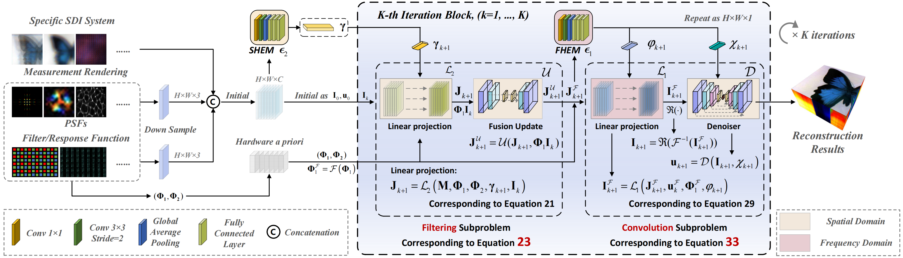

# A toolkit for solving spectral deconvolution imaging (SDI) inverse problems

[](https://arxiv.org/abs/2511.06751)
[](https://arxiv.org/abs/2511.06751)

Official research code repository for **"Hierarchical Spatial-Frequency Aggregation for Spectral Deconvolution Imaging"**, accepted for publication in **IEEE Transactions on Pattern Analysis and Machine Intelligence (TPAMI)**.

**Authors:** Tao Lv, Daoming Zhou, Chenglong Huang, Chongde Zi, Linsen Chen, and Xun Cao.

**Paper:** [arXiv:2511.06751](https://arxiv.org/abs/2511.06751)  
**Code:** [github.com/Krito-ex/SDI](https://github.com/Krito-ex/SDI)

The repository includes simulation training and evaluation, real ADIS/DOE training and reconstruction, sample measurements, calibrated PSFs, and visualization utilities. Training datasets and simulation hardware parameters are provided through the download links below; pretrained checkpoints are not included.

## Overview

**Spectral deconvolution imaging (SDI)** is a computational spectral imaging paradigm that uses wavelength-dependent point spread functions (PSFs) to encode a hyperspectral scene into a compact sensor measurement. Recovering the spectral image requires solving an ill-posed inverse problem involving convolution, spatially varying filtering, and spectral integration.

To address the challenges of scene-dependent reconstruction operators, we introduce:

- **HSFAUF — Hierarchical Spatial-Frequency Aggregation Unfolding Framework:** a physics-informed, deep-unfolding framework that separates filtering and convolution subproblems and exploits their structure in complementary computational domains.
- **SFAT — Spatial-Frequency Aggregation Transformer:** a learned prior module that aggregates spatial and frequency-domain information to refine the reconstruction.
- **HSFAUT — Hierarchical Spatial-Frequency Aggregation Unfolding Transformer:** the complete reconstruction network obtained by integrating SFAT into HSFAUF.

The paper evaluates HSFAUT on **amplitude-encoded, phase-encoded, and scattering-encoded** SDI systems, including both simulated measurements and real-world captures.


**Figure 4. Operator structure.** Compared with the IPM and APE imaging models, SDI introduces PSF-dependent convolution and a more coupled normal matrix in the spatial domain. Expressing convolution through the optical transfer function (OTF) in the Fourier domain motivates the hierarchical treatment of filtering and convolution.



**Figure 5. HSFAUT architecture.** Measurements and hardware priors initialize the reconstruction. Each unfolding stage combines a spatial-domain filtering update and fusion module with a frequency-domain convolution update and a learned denoiser. Hardware-conditioned parameter estimation guides the repeated stages that recover the hyperspectral cube.

## Highlights

- **Physics-guided reconstruction:** incorporates the SDI forward model into an interpretable unfolding architecture.
- **Hierarchical optimization:** addresses filtering and convolution through complementary spatial- and frequency-domain updates.
- **Cross-domain feature aggregation:** combines spatial detail with frequency-domain information through SFAT.
- **Versatility across optical encoders:** applies to SDI systems with different wavelength-dependent PSFs.
- **Efficient spectral recovery:** achieves competitive reconstruction quality with reduced computational and model complexity, as demonstrated in the paper.

## Repository Structure

```text
SDI/
+-- datasets/
|   +-- cave_1024_28/
|   +-- KAIST_no_selected/
|   +-- KAIST_selected_1.3_resize/
|   +-- hardware_para/
+-- simualtion/
|   +-- train_SDI/
|   +-- test_SDI/
+-- real/
|   +-- train_SDI_ADIS/
|   +-- train_SDI_DOE/
|   +-- test_SDI_ADIS/
|   +-- test_SDI_DOE/
+-- figure/
+-- visualization_tools_python/
+-- README.md
```

All commands below run from the repository root. The existing directory name is `simualtion/`.

## Getting Started

### 1. Clone the repository

```bash
git clone https://github.com/Krito-ex/SDI.git
cd SDI
```

### 2. Set up the Python environment

The experiments described in the paper are implemented in **PyTorch**. A CUDA-capable NVIDIA GPU is required by the released training and reconstruction scripts.

Install a PyTorch build compatible with your hardware using the [official installation instructions](https://pytorch.org/get-started/locally/), then install the additional packages imported by the scripts you intend to run.

Additional dependencies used by the released scripts:

```bash
pip install numpy scipy einops fvcore matplotlib scikit-image h5py
```

Package versions are not pinned in this release.

## Datasets and Experimental Setup

The paper uses the following hyperspectral datasets for simulation experiments:

| Dataset | Use in the paper |
| --- | --- |
| **CAVE-1024** | Training |
| **KAIST** | 20 scenes for training; 10 scenes for testing |

The simulation protocol follows these settings:

- **Spectral sampling:** 28 bands spanning **450–650 nm**, generated by spectral interpolation.
- **SDI encoding configurations:** amplitude-coded, phase-coded (diffractive optical element), and scattering-coded (diffuser-based).
- **PSF size used in the unified benchmark:** `512 × 512 × 28`.
- **Filtering-function size:** `256 × 256 × 28`.
- **Training described in the paper:** PyTorch, Adam optimizer, cosine-annealing schedule, 300 epochs; experiments were performed on an NVIDIA RTX 4090D GPU.

Download the prepared data and extract each archive into the corresponding directory:

| Resource | Directory | Download |
| --- | --- | --- |
| CAVE training scenes | `datasets/cave_1024_28/` | [Download](https://box.nju.edu.cn/d/9a5edf3953ad4135bfcf/) |
| KAIST training scenes | `datasets/KAIST_no_selected/` | [Download](https://box.nju.edu.cn/d/da41fc2138444874ac46/) |
| KAIST validation/test scenes | `datasets/KAIST_selected_1.3_resize/` | [Download](https://box.nju.edu.cn/d/b4da0dd885c042ef84fe/) |
| Simulation PSFs and filter functions | `datasets/hardware_para/` | [Download](https://box.nju.edu.cn/d/1bfe35154c1444d2b4f4/) |

Training `.mat` files contain `img_expand` (scaled by `65536` in the loader) or normalized `HSI` arrays in `H x W x 28` order. The current validation loader expects `586 x 586 x 28` arrays under `HSI_crop_586`; keep only prepared `.mat` scenes in the validation directory.

Simulation uses `New-200um-512-0.5.npy`, `DOE_psf_450-650-28.npy`, or `diffuser_psf_450-650-28.npy`, together with `filter_function_450-650-28.npy` (or `diffuser_filter_function_450-650-28.npy` for the diffuser). PSF arrays are stored in `28 x H x W` order.

The included real-system PSFs are `real/test_SDI_ADIS/Real_PSF/1350-200um-1024-0.5.npy` and `DOE_raw512_slim.mat` in the DOE training/testing directories' `real_PSF/` folders. Sample ADIS raw measurements and dark frames are in `real/test_SDI_ADIS/real_capture/`; DOE cropped measurements are in `real/test_SDI_DOE/real_capture/`.

For full protocol details, see the [paper](https://arxiv.org/abs/2511.06751), especially **Section IV-A (Simulation Experiment Setup)** and **Section V (Real Experiment)**.

## Training and Reconstruction

All training configurations default to `HSFAUT_3stg`. Run from the repository root:

```bash
python simualtion/train_SDI/train_SDI.py --gpu_id 0
python real/train_SDI_ADIS/train_ADIS.py --gpu_id 0
python real/train_SDI_DOE/train_DOE.py --gpu_id 0
```

For phase-encoded or scattering-encoded simulation, pass `--imaging_system DOE-based` or `--imaging_system diffuser-based`. Training outputs are saved in `<training-directory>/exp/<method>/<timestamp>/`, including `model/` checkpoints and logs. Simulation also saves validation results in `result/` when PSNR improves above 20 dB; real-system training saves a checkpoint every 10 epochs.

Evaluate a simulation checkpoint, matching the imaging system used for training:

```bash
python simualtion/test_SDI/test_SDI.py --gpu_id 0 --imaging_system ADIS --pretrained_model_path ./simualtion/train_SDI/exp/HSFAUT_3stg/<timestamp>/model/model_epoch_<epoch>.pth
```

Simulation evaluation reports PSNR and SSIM and saves `.mat` results under `simualtion/test_SDI/results/` when PSNR exceeds 20 dB. The paper additionally reports spectral angle mapper (SAM).

Reconstruct the included real measurements using a checkpoint trained for the corresponding system:

```bash
python real/test_SDI_ADIS/test_SDI_ADIS_HSFAUT_03-27.py --gpu_id 0 --pretrained_model_name HSFAUT_3stg/<timestamp>/model/model_epoch_<epoch>.pth
python real/test_SDI_DOE/test_SDI_DOE_HSFAUT_05-01.py --gpu_id 0 --pretrained_model_name HSFAUT_3stg/<timestamp>/model/model_epoch_<epoch>.pth
```

Replace `<timestamp>` and `<epoch>` with an existing training output. Real reconstruction scripts resolve checkpoint names under the corresponding training directory's `exp/` folder and save `pred` arrays in `28 x H x W` order under `<test-directory>/results/`.

## Visualization

The scripts in `visualization_tools_python/` render reconstructed HSIs and spectral PSFs. Set their input/output paths in the `__main__` blocks and match the wavelength list to the input band count before running:

```bash
python visualization_tools_python/hsi_render_rgb_real_dir_HSFAUT.py
python visualization_tools_python/psf_render_rgb.py
```

## Citation

If this repository or HSFAUT is useful in your research, please cite our paper:

```bibtex
@article{lv2026hierarchical,
  title   = {Hierarchical Spatial-Frequency Aggregation for Spectral Deconvolution Imaging},
  author  = {Lv, Tao and Zhou, Daoming and Huang, Chenglong and Zi, Chongde and Chen, Linsen and Cao, Xun},
  journal = {IEEE Transactions on Pattern Analysis and Machine Intelligence},
  year    = {2026},
  note    = {Accepted for publication}
}
```

The final IEEE DOI, volume, issue, and page numbers can be added after the official publication record is available. A freely accessible version is available at [arXiv:2511.06751](https://arxiv.org/abs/2511.06751).

## Questions and Issues

For questions, bug reports, or suggestions, please open a [GitHub Issue](https://github.com/Krito-ex/SDI/issues). When reporting a reproducibility problem, include the script, environment details, and full error message.
